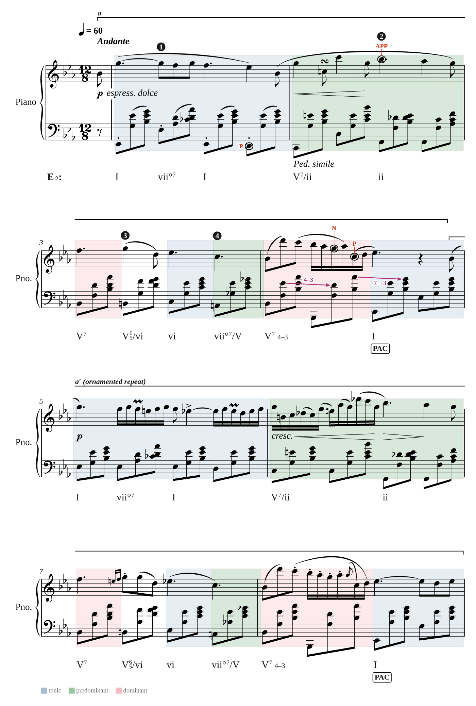
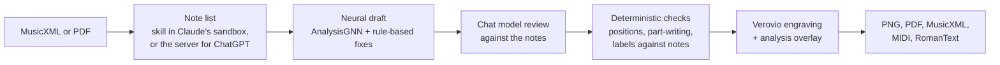

# Sheet Music Analysis

[](https://github.com/Vedat-Ozkan/sheet-music-analysis/actions/workflows/test.yml)

Attach a score (MusicXML or PDF) in Claude or ChatGPT and get back the engraved page with the harmonic analysis drawn on it, the way a theory teacher pencils it in: Roman numerals, cadences, phrases, non-chord tones and voice leading, with numbered callouts that match a written commentary. It can also check a student's own Roman numerals and a chorale's part-writing. Live at **[sheetmusicanalysis.com](https://sheetmusicanalysis.com)**.



## Results

Scored by duration against chord-by-chord analyses by human experts, on 30 held-out pieces the draft model never saw in training:

| | Key, chord and bass all match the expert |
|---|---|
| Neural draft alone | 0.48 |
| Draft reviewed by the chat model | **0.67** |
| Two independent experts, compared with each other (151 pairs) | 0.71 |

Every experiment behind these numbers, including the ones that failed, is written up in [`docs/engineering-log.md`](docs/engineering-log.md).

## How it works



The neural model drafts, the chat model judges, and anything with a clear rule is done in code. The plans are in `docs/plan.md` (v1, with research in `docs/research-2026-10-01.md`) and `docs/plan-2026-10-11.md` (after v1).

## Thanks

This project would not exist without [AnalysisGNN](https://github.com/manoskary/analysisgnn), which drafts every analysis it draws. Our sincere thanks to its authors, **Emmanouil Karystinaios, Johannes Hentschel, Markus Neuwirth and Gerhard Widmer**, for releasing the model, its code and its trained weights openly ([code](https://github.com/manoskary/analysisgnn), [weights](https://huggingface.co/spaces/manoskary/analysisgnn/tree/main/checkpoint)). If you use this project in research, please cite their paper:

> Karystinaios, E., Hentschel, J., Neuwirth, M. and Widmer, G. AnalysisGNN: A Unified Music Analysis Model with Graph Neural Networks. *International Symposium on Computer Music Multidisciplinary Research (CMMR)*, 2025.

## Layout

| Path | What it is |
|---|---|
| `engine/` | Parses MusicXML, engraves it with Verovio, draws an annotation list on the page, exports PNG and PDF (vector, through cairo; an image PDF where cairo is missing). |
| `engine/piano.py` | Reduces a large score to two piano staves for a clearer view; the analysis is still made on the original. Uses music21, loaded only when a reduction is asked for. |
| `engine/fonts/`, `tools/build_fonts.py` | Fonts for the text on the page. Score Serif is Liberation Serif with DejaVu's ♭ and ♮ added, so text with a flat never switches typeface; the `ScoreSerif-*.ttf` files are generated, so rebuild them with `.venv/bin/python tools/build_fonts.py` rather than editing them. |
| `docs/annotation-spec.md` | The annotation list format the chat model writes. |
| `examples/` | Hand-written annotation lists: Chopin, Nocturne Op. 9 No. 2, measures 1–8, and in `examples/engraving/` nine passages used by the engraving check. |
| `skill/`, `tools/build_skill.py` | The skill that runs the engine inside Claude's sandbox on the attached file; the build script bundles the engine with it into `out/sheet-music-analysis.zip`. |
| `plugin/`, `dist/sheet-music-analysis/` | The plugin: its manifest in `plugin/`, and the built plugin (skill plus a pointer to the connector at mcp.sheetmusicanalysis.com) in `dist/`, written by `tools/build_skill.py` and committed because the Claude plugin directory reads it from GitHub. Rebuild after changing `skill/`, `engine/` or `plugin/`. |
| `engine/notes.py` | Compact text form of a score's notes, which the skill passes to the server so the draft model can run without the file being uploaded. |
| `spike/` | Experiments kept for their tests and benchmarks: `spike/omr/` (PDF reading) and `spike/export/` (numerals written into MusicXML). |
| `server/`, `Dockerfile`, `Dockerfile.base` | The production MCP server (`server/app.py`): the six tools the plugin and ChatGPT use (`draft_analysis`, `render_analysis`, `correct_bars` and `read_pdf` for ChatGPT; `draft_from_notes` and `play` for Claude) (reads a PDF with Audiveris through `engine/read_pdf.py` and shows the engraved result to check before the analysis; `tests/test_read_pdf.py` runs when `AUDIVERIS` points at an Audiveris launcher), daily limits, storage in a Cloud Storage bucket that deletes scores and pages after a day. `server/deploy.sh PROJECT_ID` builds the image on Cloud Build and deploys it to Cloud Run (one instance at most, two calls at once). Run locally with `.venv/bin/python -m server.app` (port 8080, files under `out/server/`). |
| `site/`, `wrangler.jsonc` | The website at sheetmusicanalysis.com: landing page, how-to-use, privacy and terms, plus the clef icons the server reports to chat hosts. Static files served by Cloudflare; publish with `npx wrangler@4 deploy`. `site/.assetsignore` keeps local `.uuid` files off the site. `site/piano/` holds the chat player's piano samples; it is not in git, so run `uv run --with soundfile python tools/piano_samples.py` before publishing. |
| `openai-plugin/` | The ChatGPT listing package: `plugin.json` (listing text, icon, review test cases), `mcp.json` (the server address) and icons. Upload it zipped at platform.openai.com/plugins: `cd openai-plugin && zip -r ../out/sheet-music-analysis-openai.zip plugin.json mcp.json assets`. Bump `version` with each upload. |
| `proxy/` | A Cloudflare Worker that serves the Cloud Run server at mcp.sheetmusicanalysis.com, the address given to Claude and ChatGPT. Publish with `npx wrangler@4 deploy -c proxy/wrangler.jsonc`. |
| `engine/read_pdf.py`, `engine/triplets.py` | Reading a PDF: Audiveris from our fork (https://github.com/Vedat-Ozkan/audiveris, release `5.11.0-sma.2`, AGPL-3.0; never delete a release, publish a new one), up to three readings with different settings keeping the one with fewest bars that don't add up, then cleaning and inferring triplets printed without a "3" (log 35). Audiveris reads text such as tempo words only with Tesseract's English data, `eng.traineddata` from https://github.com/tesseract-ocr/tessdata (Apache-2.0, pinned in `Dockerfile.base` and `skill/scripts/read_pdf.py`), in a `tessdata` folder beside its `bin` folder. |
| `engine/correct.py` | Replaces misread bars of a reading with corrected bars in the `engine/notes.py` text form, for fixing a PDF reading in the chat. Used by the skill's `correct_score.py` and the server. |
| `engine/part_writing.py`, `engine/check_analysis.py`, `engine/comparison.py`, `engine/notation.py`, `engine/export.py` | Voice-leading checks for chorale-style scores (the draft's PART-WRITING CHECK); reading a student's numerals and comparing them with ours (the STUDENT CHECK; `comparison.py` is shared with `eval/`); ABRSM and figured-bass label text; writing the numerals into the user's MusicXML as bass lyrics. All used by the skill and the server. |
| `spike/omr/bench/` | PDF reading benchmark: 23 pieces, 57 PDFs (MuseScore, LilyPond, Verovio, scans), scored at the engine's level by kind of mistake; `bench-heldout*` are unseen sets. Only the scripts are committed: `build.py` rebuilds the pieces and PDFs (some music21 encodings' licences are unverified, so they are not redistributed). |
| `engine/draft.py` | Runs the draft model and condenses its output into chords, cadences, phrase ends and non-chord tones. |
| `vendor/analysisgnn/` | Clone of the draft model (not committed; see `.gitignore`). |

**Shipping the chat player, in this order.** The skill's note list now carries an `x:` line per bar (tempo, dynamics, pedal, ornaments), which servers from before the player reject, failing the whole analysis. So: (1) deploy the server (`server/deploy.sh`), which reads both old and new note lists; (2) make the samples and publish the site (`tools/piano_samples.py`, then `npx wrangler@4 deploy`), which also publishes the privacy page that says note lists are kept for a day; (3) only then publish the skill and plugin.

## Setup

```bash
uv sync --python 3.11
.venv/bin/python -m pytest
```

Render the example to `out/`:

```bash
.venv/bin/python -c "
from engine.annotate import render
from engine.annotations import AnnotationList
score = open('tests/data/chopin_nocturne_op9_no2.mxl', 'rb').read()
notes = AnnotationList.model_validate_json(open('examples/chopin_op9_no2_m1-8.json').read())
page = render(score, notes, measures=(1, 8))
open('out/example.png', 'wb').write(page.png(1, width=1600))
open('out/example.pdf', 'wb').write(page.pdf())
"
```

## Platform test

The first test server, which checked how a score gets in and how a page shows up in each chat app (plan step 1), was replaced by `server/` and removed. Its results are in `docs/gate1-results.md`.

## Robustness

```bash
.venv/bin/python -m tools.robustness            # every score, every stage
.venv/bin/python -m tools.robustness --matching ravel
```

Runs 31 scores through reading, the note table, the note list, engraving, the draft model and rendering: Bach chorales, Classical and Romantic quartets, songs and piano music from the music21 corpus, and impressionist and early twentieth-century piano music (Ravel, Debussy, Satie, Scriabin, Rachmaninoff, Prokofiev, Schoenberg) downloaded on first use into `out/`. The downloaded transcriptions are for local testing and are not committed. Results go to `out/robustness/report.json`.

Two PDFs in `tests/data` also run through Audiveris and then the same stages, with slurs left out as in the server's default reading. Set `AUDIVERIS` to its launcher (locally, `AUDIVERIS=spike/omr/tools/audiveris-deb/x/opt/audiveris/bin/Audiveris`, with `eng.traineddata` in `spike/omr/tools/audiveris-deb/x/opt/audiveris/tessdata`); when it is unavailable, these cases report `NOT RUN`. The report includes page counts, scan detection, skipped pages and the reading notice.

## Engraving check

```bash
.venv/bin/python -m tools.engraving_check --tag NAME
```

Draws nine analysed passages, from a Bach chorale to Dvořák's full orchestra, with the annotation lists in `examples/engraving/`. It counts labels that overlap or crowd the music, and places where Verovio sets dynamics, words or clef changes on top of notes. Pages go to `out/engraving/NAME/` as PNG and PDF for comparing rounds; the counts are a first filter, and the pages still need looking at.

## Evaluation

```bash
.venv/bin/python -m eval.run                                   # draft model alone, scored against expert chord labels
.venv/bin/python -m eval.review                                # Opus at medium effort reviews each passage, as the skill does
.venv/bin/python -m eval.run --reviewed out/eval/reviewed/opus-medium   # score the reviewed analyses the same way
.venv/bin/python -m eval.judge                                 # compare with what a teacher wrote about each piece
```

`eval/pieces.py` lists 23 pieces from Bach to Ravel, each paired with a published human analysis (how they were chosen is in `reports/Scores with published analyses.md`). Twelve have a chord-by-chord reading by a human analyst that a script can compare against; the rest have prose only. Scores, labels and results are kept in `out/eval/` and are not committed. The review and judge steps call `claude -p`. With `ANTHROPIC_API_KEY` in `.env` (not committed) they bill to that API key, and each run's cost is added to `out/api-spend.jsonl`; without it they use the account Claude Code is signed in with.

Results, and the problems met along the way, are written up in `docs/engineering-log.md`.

The score for a reading is the share of the piece, by duration, where it agrees with the human labels: on the key, on the chord's root, on the whole chord, on the chord with its bass note, and on all of these together (`full`). `reference_fit` is the share of notes that belong to the human's chord; a low value means the bar numbers of the labels and the file do not line up.

## Draft model

AnalysisGNN drafts the analysis; the chat model reviews it. It runs in its own environment (`.venv-agnn`, Python 3.11, PyTorch 2.5 CPU) and `engine/draft.py` calls it as a subprocess, so the engine itself needs no ML packages.

```bash
uv venv .venv-agnn --python 3.11 && export VIRTUAL_ENV=$PWD/.venv-agnn
uv pip install torch==2.5.0 --index-url https://download.pytorch.org/whl/cpu
uv pip install pyg-lib torch-scatter torch-sparse torch-cluster -f https://data.pyg.org/whl/torch-2.5.0+cpu.html
uv pip install torch-geometric pytorch-lightning partitura music21 numpy pandas scikit-learn torchmetrics wandb tqdm gitpython scipy requests matplotlib seaborn imbalanced-learn
uv pip install --no-deps "git+https://github.com/manoskary/graphmuse.git@main"   # the PyPI 0.0.5 wheel is too old for the checkpoint
git clone --depth 1 https://github.com/manoskary/analysisgnn vendor/analysisgnn && uv pip install --no-deps -e vendor/analysisgnn
mkdir -p artifacts/models && curl -L -o artifacts/models/model.ckpt \
  https://huggingface.co/spaces/manoskary/analysisgnn/resolve/main/checkpoint/model.ckpt
```

Notes on the weights (checked 2026-10-01):

- The checkpoint comes from the author's public Hugging Face Space `manoskary/analysisgnn`, which is marked MIT. The Weights & Biases artifact named in the upstream README is no longer accessible to ordinary accounts.
- The author has called this public version "effectively deprecated" and said a better model with an open Hugging Face checkpoint will follow once a paper review finishes (quoted in upstream issue #9, May 2026).
- Two upstream quirks are worked around in `engine/models/analysisgnn_runner.py`: the Roman numeral output is decoded with the wrong table, so numerals are rebuilt from the degree, quality and inversion outputs; and the confidences of those outputs are flattened by repeated softmax, which the runner undoes.
- On this machine a full analysis of the 38-bar nocturne takes about 4.5 s and 0.8 GB of memory on CPU, model loading included.

Draft table for a range of measures:

```bash
.venv/bin/python -c "
from engine import draft
from engine.render import load_toolkit
from engine.score import ScoreIndex
score = open('tests/data/chopin_nocturne_op9_no2.mxl', 'rb').read()
print(draft.as_text(draft.draft(ScoreIndex(load_toolkit(score).getMEI())), 1, 8))
"
```

## Test score

`tests/data/chopin_nocturne_op9_no2.mxl` is a community transcription from the MuseTrainer public-domain library (https://github.com/musetrainer/library), with one change: the flat above the turn in bar 2, which printed editions have, was added. Its pedal and trill markings are incomplete, so playback is tested on `tests/data/chopin_nocturne_op9_no2_pdmx.mxl`, the same nocturne from the PDMX dataset (Long et al., CC BY 4.0; score `metadata/4/2208476.json`, marked public domain by its uploader), which marks pedal in 30 of its 35 bars and writes out the turn in bar 2. `tests/data/chopin_prelude_op28_no4_audiveris.mxl` is Audiveris 5.11.0's reading of the Mutopia Project PDF of Chopin's Prelude Op. 28 No. 4 (Mutopia-2016/10/28-468, placed in the public domain by its typesetter), kept with its reading mistakes for `tests/test_read_pdf.py`.

`tests/data/chopin-28-4-mutopia.pdf` is that born-digital public-domain Mutopia PDF (https://www.mutopiaproject.org/cgibin/piece-info.cgi?id=468). `tests/data/mozart-k545-1-scan.pdf` contains pages 234–237 of the public-domain Peters edition of Mozart's sonatas, from the archive.org scan https://archive.org/details/31761034110379. Both were copied from the ignored `spike/omr` inputs documented in `spike/omr/RESULTS.md`.
